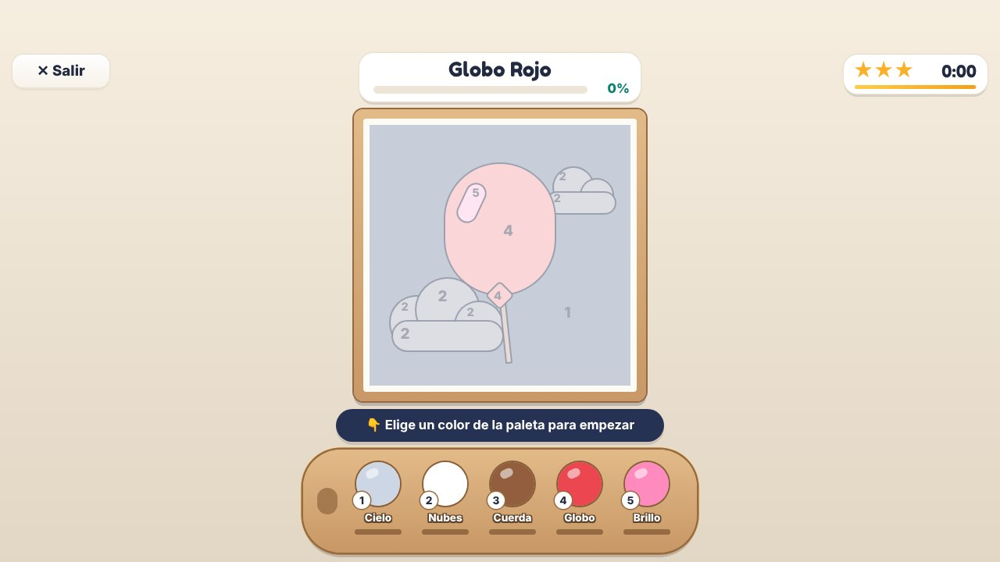
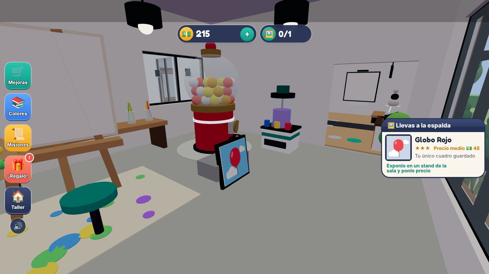
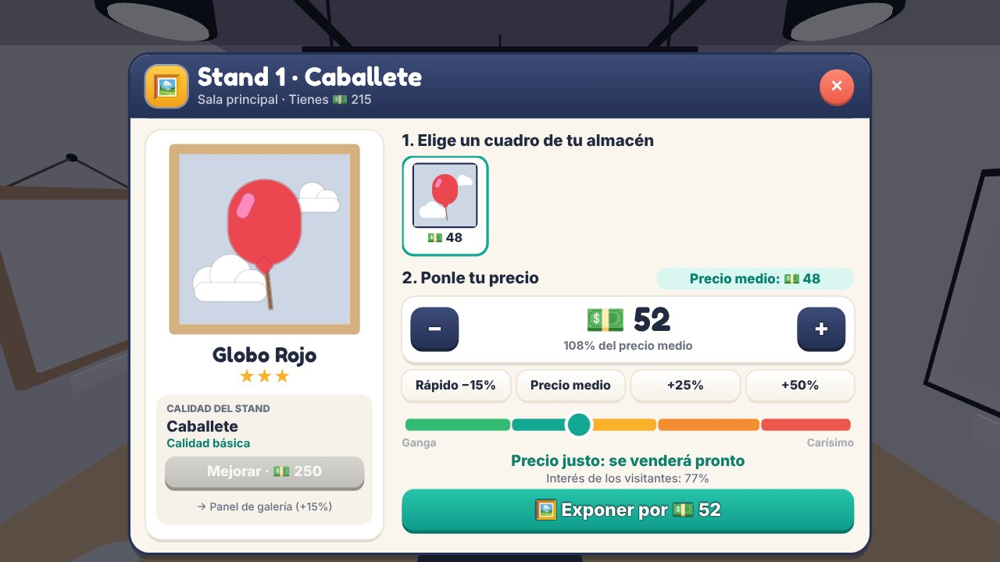
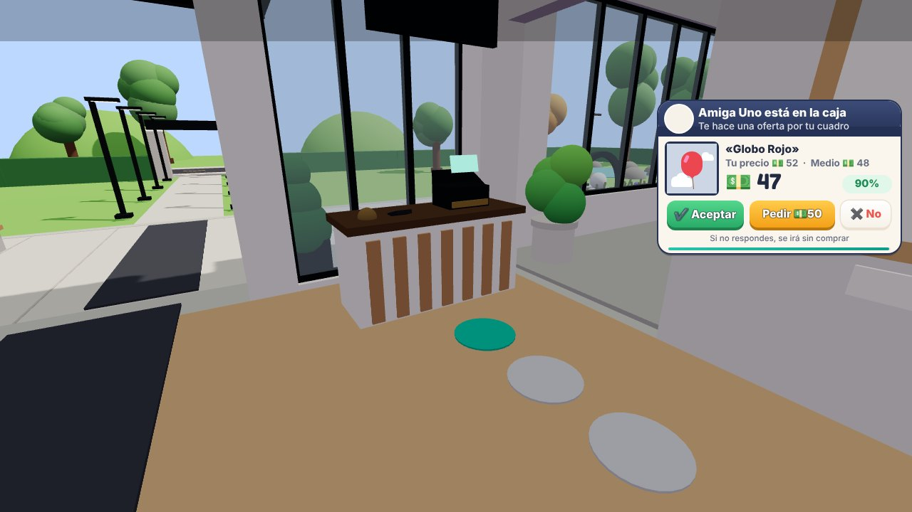
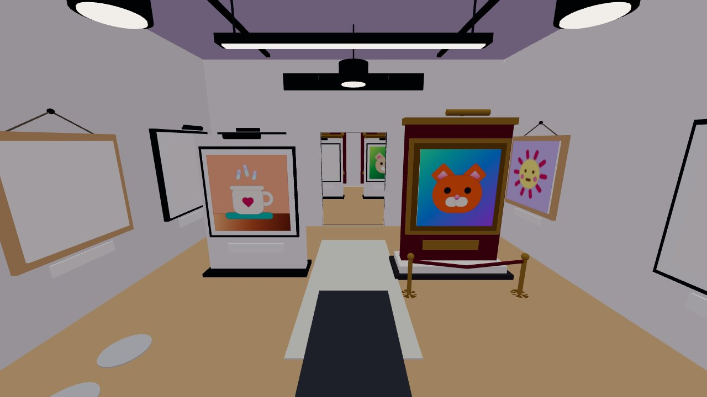
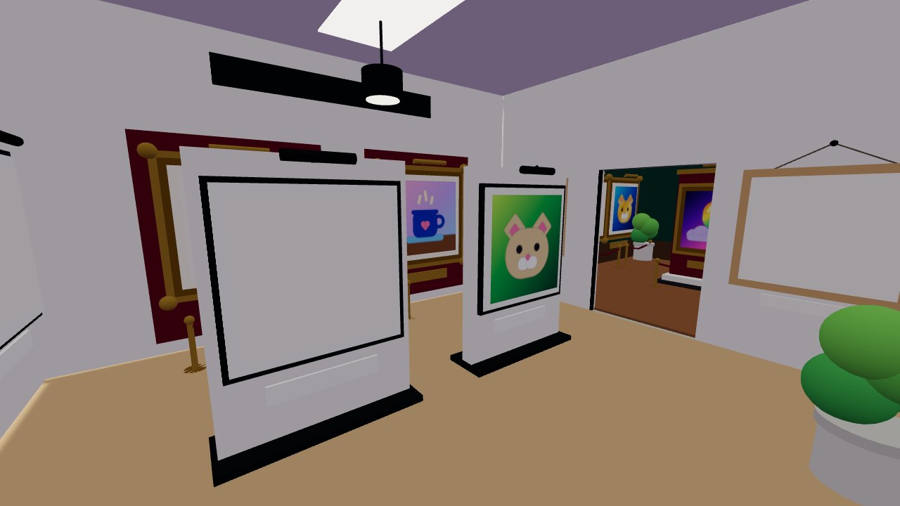
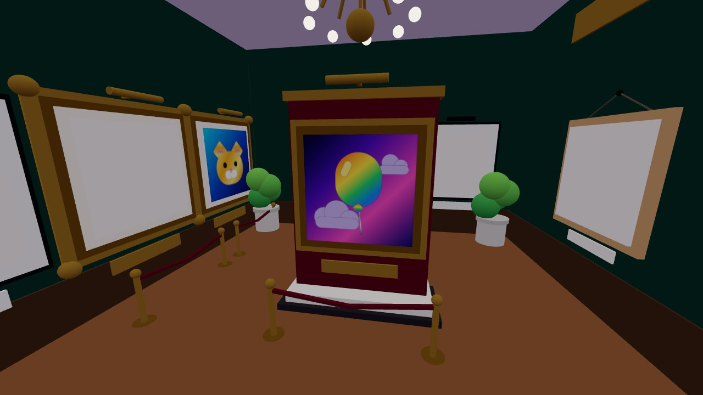
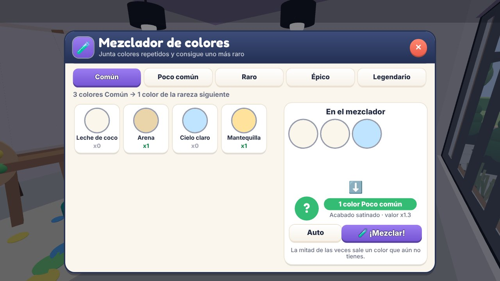

# 🎨 Galería Pincelada (juego de Roblox)

Cada jugador aparece en **su propio terreno privado**: una galería de arte
moderna (volumen blanco con grandes cristaleras) con un **taller** forrado de
madera al lado, plaza con estanque, jardín y una calle por donde llegan los
visitantes. En el taller sacas pinturas de una máquina de colores (con
rarezas y acabados), eliges un diseño, decides qué color va en cada parte y lo
pintas a mano, **color por color**. Después lo expones en un **stand** de la
sala de exposición **con el precio que tú quieras**: entran visitantes
(avatares reales de Roblox), eligen un cuadro, van a la **caja** y te pagan o
te hacen una **oferta**. Con el dinero compras más stands, los mejoras y
**amplías la galería** con salas nuevas.

La interfaz tiene estilo de **estudio de arte**, para todo el público:
cabeceras azul tinta, fondos crema, botones con relieve y acentos turquesa,
ámbar y coral.


| Tu galería | Dentro del taller |
| --- | --- |
|  |  |

## Cómo se juega

Apareces **dentro de tu taller**, con la máquina de colores a un lado, el
caballete al otro y el mezclador junto a la pared. Un **tutorial guiado de 5
pasos** te acompaña: un panel con la guía (paso, instrucción y progreso; se
puede saltar), un **camino luminoso** desde tu personaje hasta el objetivo, el
objeto resaltado y una flecha encima.


1. **Máquina de colores**: los colores **solo se tiran en la máquina** del
   taller. Acércate y pulsa **E** (o toca el aviso en el móvil). Mientras la
   máquina gira el aviso desaparece y aparece una tarjeta con el color que te
   tocó. El **Auto-Rolling** es una mejora de la tienda; una vez comprada, se
   enciende o se pausa con **F** en la propia máquina.
   - **Tirada asegurada**: si pasan 12 tiradas sin nada Raro, la siguiente es
     Raro o mejor (el cartel de la máquina muestra cuántas faltan).
   - **Bonus por descubrir**: cada color nuevo para tu colección te da monedas
     (más cuanto más raro).

   Hay **43 colores para coleccionar** más 16 básicos infinitos. Cada rareza
   **multiplica** el valor del cuadro y tiene su propio **acabado**, que se ve
   en la paleta, en el cuadro terminado y en la sala:

   | Rareza | Acabado | Multiplicador |
   | --- | --- | --- |
   | Básico (infinito) | Mate | x1.0 |
   | Común (pasteles) | Mate | x1.1 |
   | Poco común (vivos) | Satinado: brillo suave | x1.3 |
   | Raro (tonos joya) | Brillante: reflejo de esmalte | x1.6 |
   | Épico | Degradado (lava, aurora, flor de cerezo...) | x2.2 |
   | Legendario | Metálico con destello que se mueve (oro, plata, nácar...) | x3.5 |
   | Mítico | Mágico: los colores giran (arcoíris, galaxia, fénix, holograma) | x6.0 |

   Los cuadros con colores legendarios o míticos **brillan** en la sala.
2. **Mezclador de colores** 🧪: junta colores repetidos de una rareza y
   consigue **uno de la rareza siguiente** (3 comunes → 1 poco común, 4 raros →
   1 épico, 5 legendarios → 1 mítico...). La mitad de las veces sale un color
   que aún no tienes. El botón *Auto* rellena el mezclador con tus repetidos.
3. **Elige un diseño** en el caballete: hay **20 diseños en 5 niveles**
   (globo, gatito, koi, castillo, ballena, faro…). Los niveles altos se venden
   más caros. Para abrir un nivel tienes que pintar todos los diseños del
   anterior y luego desbloquear cada uno con dinero.
4. **Elige tus colores**: cada área del dibujo (cielo, globo, nubes…) toma el
   color que elijas, con el **valor del cuadro en vivo**. El botón
   ✨ *Mejores colores* elige automáticamente los que más rinden.
5. **Colorea por números, color por color**: el dibujo aparece como un
   **boceto numerado**: cada zona lleva el número de su bote en la **paleta de
   pintor de madera**. Al elegir un color (con el ratón o las teclas 1-9) **sus
   zonas se iluminan**: más color, un contorno grueso que late, un destello al
   elegirlo y sus números grandes en un círculo; el resto del dibujo se queda
   casi en blanco. El pincel solo deja pintura en esas zonas, con vetas como el
   óleo, y nunca se sale de la figura; cuando cubres casi toda una figura, se
   completa con su color y su acabado. El **cronómetro con estrellas** premia
   la rapidez (⭐⭐ +10%, ⭐⭐⭐ +25%). Con la mejora 🖌️ *Pincel grande* el trazo
   es más ancho y con 🪣 *Cubeta mágica* rellenas una figura de un toque.
6. **Exponlo en un stand con tu precio**: el cuadro no se vende al
   terminarlo. Lo **llevas a la espalda**, vas a la sala y pulsas sobre un
   stand. En su panel eliges qué cuadro exponer (puedes guardar hasta 8) y
   **pones el precio**: el juego te enseña el **precio medio** (lo que suelen
   pagar los visitantes en ese stand), botones − / + y atajos (*Rápido −15%*,
   *Precio medio*, *+25%*, *+50%*), y un medidor que va de **Ganga** a
   **Carísimo** con el interés de los visitantes. Cuanto más caro, menos
   visitantes se animan (y si lo ven muy caro te lo dicen).
7. **Los visitantes van a la caja**: entran caminando, miran los cuadros,
   eligen uno y, si les convence, **van a la caja** (hacen cola en el
   mostrador). Si tu precio entra en su presupuesto, **te lo pagan**; si no,
   **te hacen una oferta** que aparece en pantalla (también mientras pintas):
   - ✔ **Aceptar** la oferta.
   - **Pedir más**: le propones un precio a medio camino; puede aceptar,
     hacerte una **última oferta** o irse ofendido.
   - ✖ **Rechazar**: se va sin comprar y el cuadro sigue expuesto.

   Si no respondes a tiempo se va, salvo que tengas la mejora **Cajero** 🧑‍💼:
   un cajero detrás del mostrador acepta solo las ofertas buenas (al menos el
   85% de tu precio). A veces llega un **coleccionista VIP 👑** con mucho más
   presupuesto. Quien compra se lleva el cuadro bajo el brazo.
8. **Compra stands y amplía la galería**: empiezas con un caballete gratis. En
   la sala hay huecos marcados con **＋ Stand** y su precio; mantén **E** para
   comprar uno. Cada stand se puede **mejorar** desde su panel:

   | Calidad | Stand de pie | Marco de pared | Precio medio |
   | --- | --- | --- | --- |
   | 1 | Caballete | Marco sencillo de roble | +0% |
   | 2 | Panel de galería con foco | Marco de galería negro con foco | +15% |
   | 3 | Vitrina de lujo (terciopelo, mármol y cordón) | Marco dorado sobre terciopelo | +35% |

   Cuando tienes suficientes stands, la tapia de obra del fondo te deja
   **ampliar la galería**: la **Sala del jardín** (6 stands y 💵2.500) y la
   **Sala de los maestros** (14 stands y 💵30.000), con paredes verdes, zócalo
   de madera y lámpara de araña. En total hay **24 huecos** para stands.

| Elige un diseño | Elige tus colores |
| --- | --- |
|  |  |
| **Boceto numerado** | **Las zonas del color elegido se iluminan** |
|  |  |
| **¡Terminado!** | **Lo llevas a la sala** |
|  |  |
| **Panel del stand: tu precio y el precio medio** | **Oferta en la caja** |
|  |  |

| Sala principal | Sala del jardín | Sala de los maestros |
| --- | --- | --- |
|  |  |  |

### Lo que te engancha

- **Misiones diarias 📜**: 3 misiones nuevas cada día (pintar, vender, tirar,
  conseguir colores raros, cuadros de 3 estrellas, ganar monedas, vender por
  encima del precio medio). Si completas las 3 te llevas un **color Épico o
  mejor**.
- **Regalo diario 🎁** con **racha de 7 días**: cada día más monedas y un color
  raro; el día 7, un color Épico.
- **Colección de colores**: 43 pinturas para descubrir, con su acabado y su
  probabilidad por tirada. Las que no tienes salen como «???».
- **Maestría** por diseño: 🥉 Bronce (3 cuadros, +5%), 🥈 Plata (8, +10%) y
  🥇 Oro (20, +20%).
- **9 mejoras**:
  - Máquina: suerte, velocidad y **Auto-Rolling** (tira sola mientras pintas).
  - Pintura: pincel grande (trazo más ancho) y cubeta mágica (rellena una
    figura de un toque).
  - Galería: precios, fama (más visitantes y más VIP), **cajero** y
    decoración (plantas, alfombra, escultura, guirnalda de luces, lámpara y
    focos).
- **Stands y salas** para ir llenando: 24 huecos, 3 calidades de stand y 2
  ampliaciones.
- **Visitantes con avatares reales**: tus amigos de Roblox (o avatares
  conocidos) entran caminando con animaciones, esquivan los stands, admiran
  los cuadros, hacen cola en la caja, regatean y se llevan el cuadro.
- El progreso se guarda automáticamente (las partidas de versiones anteriores
  conservan sus cuadros: cada marco pasa a ser un stand de galería).

| Misiones | Regalo diario |
| --- | --- |
|  |  |
| **Mejoras** | **Colección** |
|  |  |
| **Mezclador de colores** | **Los 20 diseños** |
|  |  |

## Cómo abrirlo en Roblox Studio

### Opción fácil

1. Descarga **`GaleriaPincelada.rbxlx`**.
2. Ábrelo con **Roblox Studio** y pulsa **Play** ▶️. Todo (terreno, edificios,
   visitantes, interfaz) se crea por código y hay una pantalla de carga
   mientras se construye tu galería.

Para **publicarlo** y que se guarde el progreso:

1. *Archivo → Publicar en Roblox*.
2. *Configuración del juego → Seguridad*: activa **«Permitir que Studio acceda
   a los servicios de API»**.
3. *Configuración del juego → Lugares*: pon el **máximo de jugadores en 12**
   (cada servidor tiene 12 terrenos; si se llenara, el siguiente jugador
   recibe el primer terreno que quede libre).

### Opción para recibir cambios sin descargar nada (Rojo)

1. Clona el repositorio (por ejemplo con GitHub Desktop).
2. Instala [Rojo](https://rojo.space) y su plugin de Studio.
3. Ejecuta `rojo serve` en la carpeta del repositorio y pulsa
   *Rojo → Connect* en Studio.
4. Para cada actualización solo tienes que hacer *Pull* en GitHub Desktop y
   Studio se actualiza solo.

## Personalizar

- **Diseños nuevos**: `src/shared/Designs.lua`. Cada diseño se arma con
  figuras: `R` (rectángulo), `C` (círculo), `P` (píldora), `Heart`,
  `Sparkle` y `Ring`, sobre un lienzo de 0 a 1. Cada figura pertenece a un área.
- **Colores, rarezas, acabados y mezclas**: `src/shared/Colors.lua`.
- **Economía, mejoras, estrellas, misiones y tutorial**: `src/shared/Config.lua`.
- **Salas, huecos, stands, precio medio y regateo**: `src/shared/Exhibition.lua`.
- **Terreno y edificios** (galería, salas, stands, caja, taller, jardín,
  calle): `src/server/Services/WorldBuilder.lua`.

## Estructura

```
src/
  first/       Pantalla de carga
  shared/      Colores, diseños, configuración (servidor y cliente)
  server/      Terrenos, visitantes, guardado, máquina, stands, ofertas, misiones
  client/      Interfaz: HUD, máquina, diseños, colores, pintura, stands, ofertas,
               mezclador, tienda...
tests/sim/     Simulador que ejecuta el juego completo fuera de Roblox
```

El servidor valida todo: pinturas suficientes, diseño desbloqueado, tiempo
mínimo de pintura, estrellas según el tiempo real, precios dentro de un
margen razonable, ofertas, mezclas y compras. Así los jugadores no pueden
hacer trampas.
