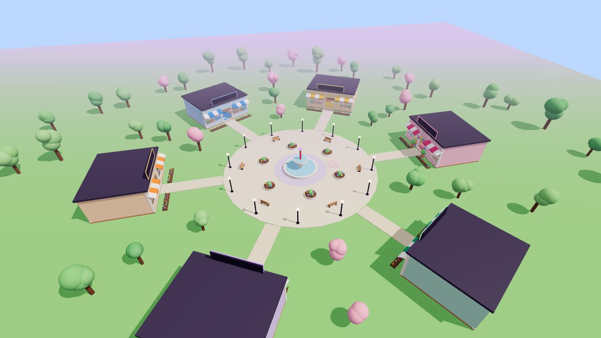
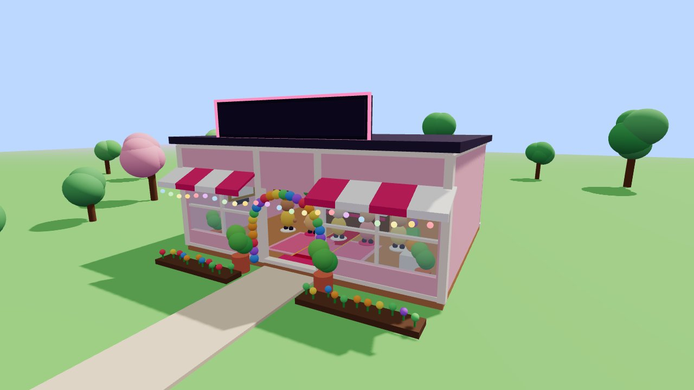
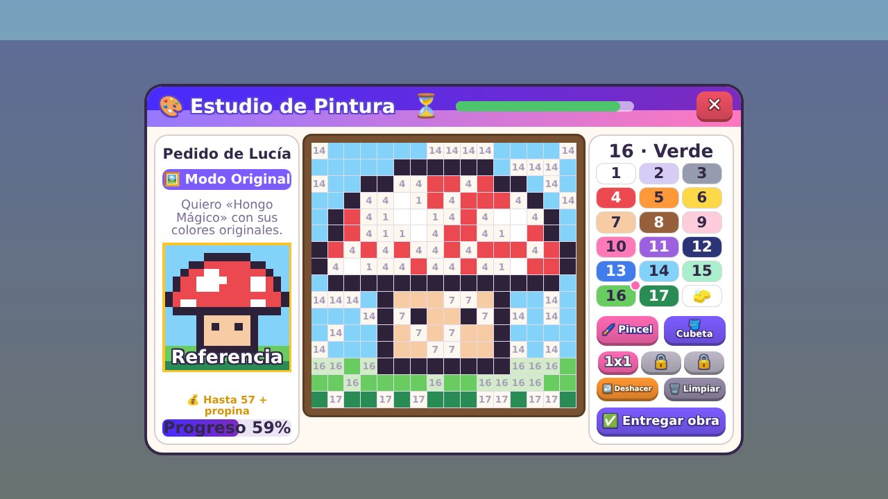
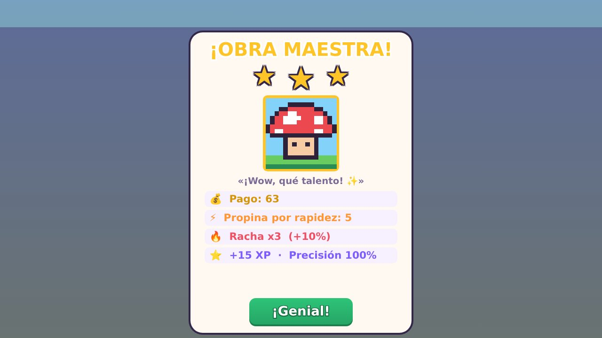
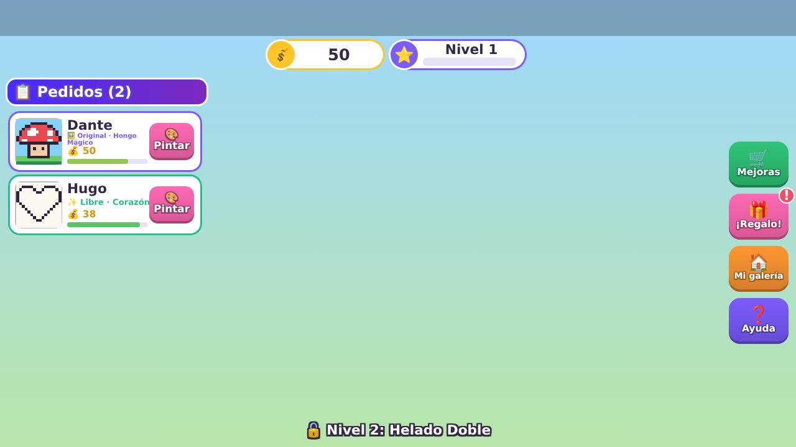
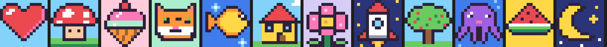

# 🎨 Galería Pincelada (juego de Roblox)

Tienes tu propia galería de arte. Los clientes entran con un pedido, tú pintas
la obra sobre una imagen ya dibujada (estilo «pinta por números»), la entregas
y te pagan según lo bien y lo rápido que la hagas. Con el dinero mejoras la
galería, subes de nivel y desbloqueas obras nuevas. Tus mejores cuadros quedan
colgados en las paredes para que todos los vean.



| Tu galería | Estudio de pintura |
| --- | --- |
|  |  |
| **Resultado de un pedido** | **Interfaz y pedidos** |
|  |  |

## Cómo se juega

1. Los clientes (muñequitos con sombrero, ¡y a veces VIP con corona 👑!) entran
   a tu galería y esperan con un globo que muestra lo que quieren.
2. Pulsa **Pintar** en la lista de pedidos o acércate y pulsa **E**.
3. Pinta sobre la imagen:
   - 🪣 **Cubeta**: rellena una zona entera de un clic.
   - 🖌️ **Pincel** (1x1, y 2x2 o 3x3 con mejoras) para detalles.
   - 🧽 Borrador, ↩️ deshacer y 🗑️ limpiar.
   - Los números indican el color de cada casilla, y las casillas del color
     que tienes seleccionado se iluminan.
4. Pulsa **Entregar obra**. Ganas de 0 a 3 ⭐ según la precisión, y propina
   si entregas rápido. Si el cliente se cansa de esperar, se va enfadado.

### Tipos de pedido

| Modo | Qué pide el cliente |
| --- | --- |
| 🖼️ Original | La obra con sus colores de referencia. |
| 🔀 Remix (nivel 2) | La obra, pero cambiando un color por otro («el corazón, pero azul»). |
| 🎨 Temática (nivel 3) | Pintarla solo con una gama: cálidos, fríos, pastel, noche o bosque. |
| ✨ Libre | Como quieras, ¡pero con muchos colores! |

### Lo que te engancha

- **12 obras** para desbloquear por nivel (corazón, hongo, helado, gatito, pez,
  casita, flor, sandía, cohete, manzano, pulpo, luna y estrellas).
- **Rachas 🔥**: cada entrega de 2 o más estrellas seguida suma +5% de pago (hasta +50%).
- **Clientes VIP** que pagan x2.5 y dan doble experiencia.
- **7 mejoras**: precios, paciencia, fama (más clientes), propinas, VIP,
  pinceles gruesos y decoración (plantas, alfombra roja, estatua, guirnalda de
  luces, candelabro y arco de globos que aparecen en tu galería).
- **Regalo diario 🎁** que crece si vuelves varios días seguidos.
- **Galería en las paredes**: tus últimas 7 obras se cuelgan enmarcadas y la
  última aparece en el caballete.
- Ranking con **Monedas, Nivel y Obras** en la tabla de jugadores.
- El progreso se guarda automáticamente.



## Cómo abrirlo en Roblox Studio

### Opción fácil

1. Descarga el archivo **`GaleriaPincelada.rbxlx`** de este repositorio.
2. Ábrelo con **Roblox Studio** (doble clic o *Archivo → Abrir*).
3. Pulsa **Play** ▶️. Todo el mundo, los clientes y la interfaz se crean por
   código, así que no hace falta nada más.

Para **guardar el progreso** de los jugadores:

1. *Archivo → Publicar en Roblox*.
2. *Inicio → Configuración del juego → Seguridad* → activa
   **«Permitir que Studio acceda a los servicios de API»**.
3. En *Configuración del juego → Lugares* pon el **máximo de jugadores en 6**
   (hay 6 galerías; si entra un séptimo jugador puede pasear pero no tendrá galería).

Sin publicar, el juego funciona igual pero no guarda (sale un aviso en la salida).

### Opción para desarrolladores (Rojo)

```bash
rojo serve           # sincroniza el código con Studio en vivo (plugin de Rojo)
rojo build -o GaleriaPincelada.rbxlx   # vuelve a generar el archivo del juego
```

## Personalizar

- **Nuevas obras**: en `src/shared/Templates.lua` cada obra es una cuadrícula
  de 16x16 letras. Cada letra es un color de `src/shared/Palette.lua` y la `k`
  es el contorno negro fijo. Copia un bloque, dibuja con letras y elige nivel,
  precio, experiencia y paciencia.
- **Economía**: precios, mejoras, rachas, VIP y velocidad de clientes están en
  `src/shared/Config.lua`.
- **Mundo**: colores de las galerías, plaza y decoraciones en
  `src/server/Services/WorldBuilder.lua`.

## Estructura

```
src/
  shared/            Config, paleta, plantillas y puntuación (servidor y cliente)
  server/
    Main.server.lua  Galerías, pedidos, pagos, niveles, mejoras, regalo diario
    Services/        Guardado (DataStore), constructor del mundo y clientes NPC
  client/
    Main.client.lua  Conecta la interfaz con el servidor
    World.lua        Cuadros de la galería y globos de pedido
    UI/              HUD, estudio de pintura, tienda, resultados y estilos
tests/sim/           Simulador que ejecuta el juego completo fuera de Roblox
```

El servidor valida todo (que el pedido exista, que el lienzo sea válido y la
puntuación), así que los jugadores no pueden hacer trampas enviando datos falsos.
