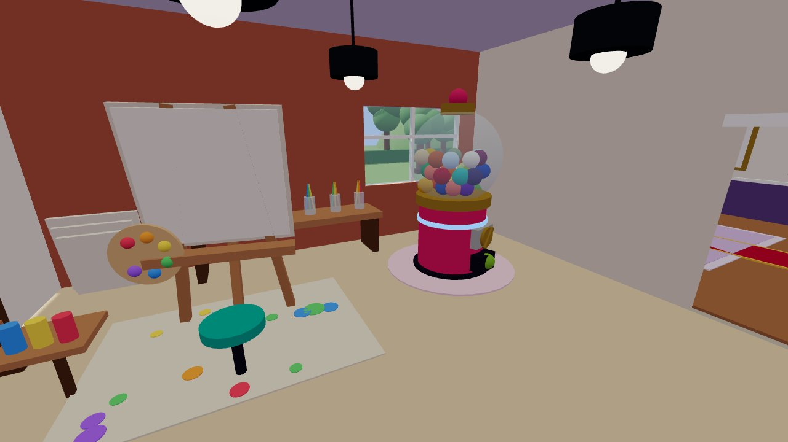
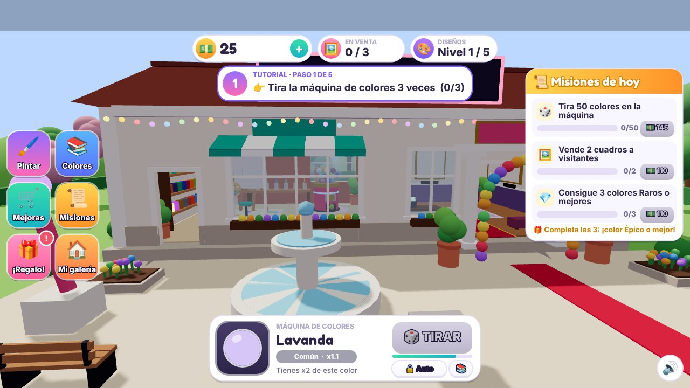
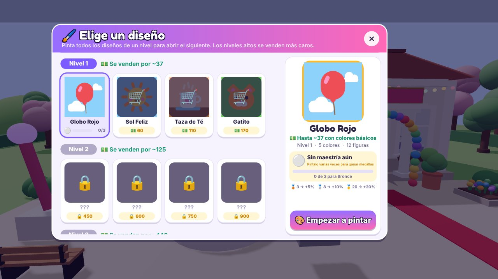
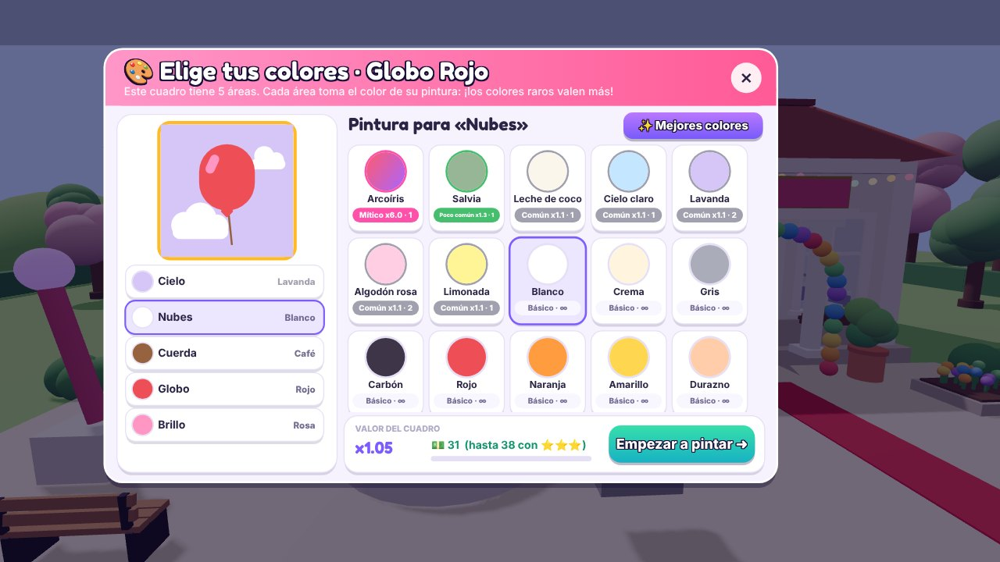
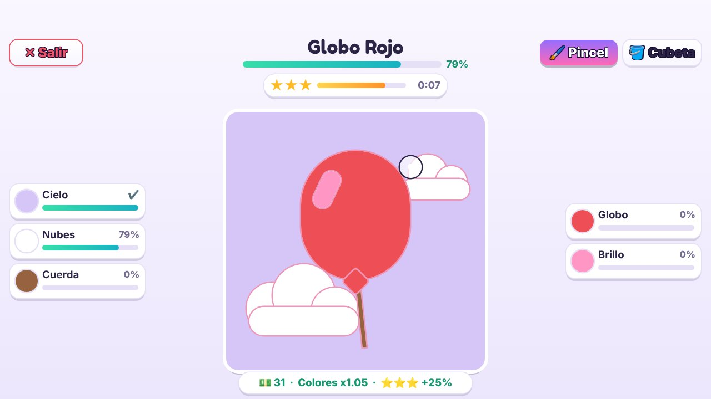
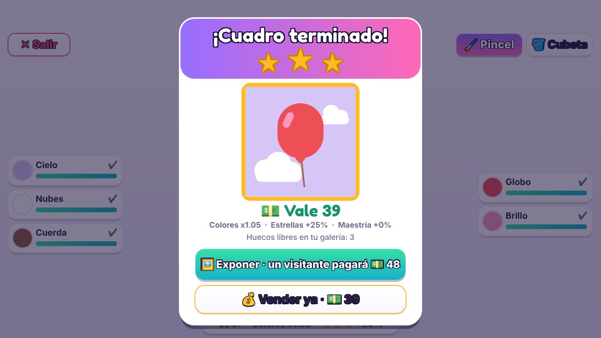
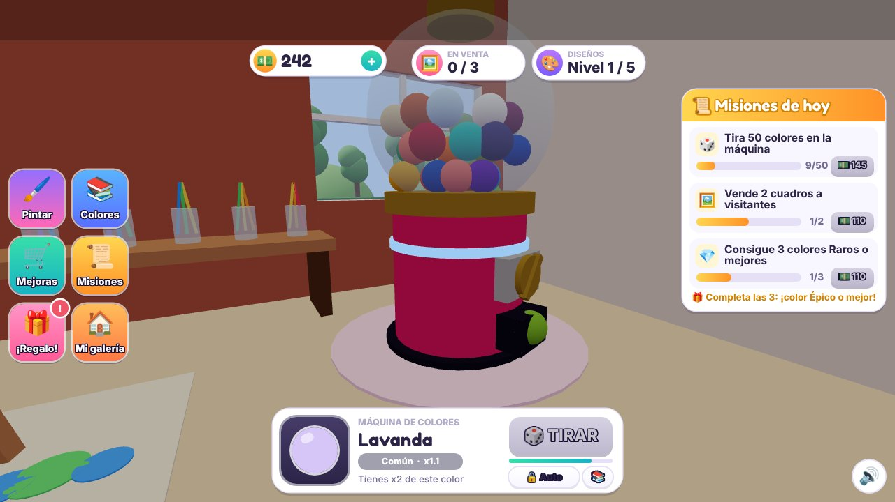
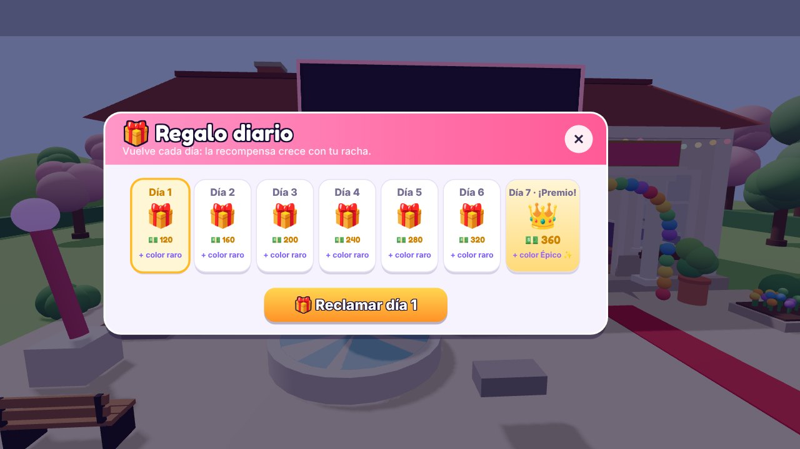
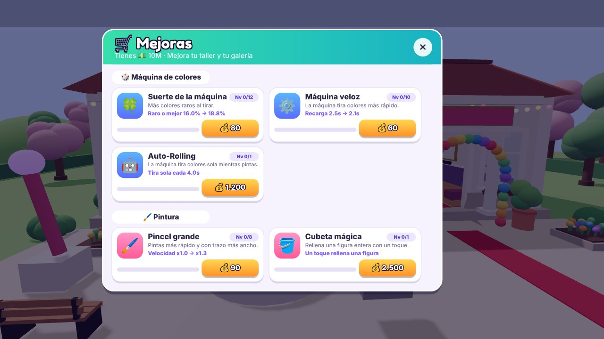
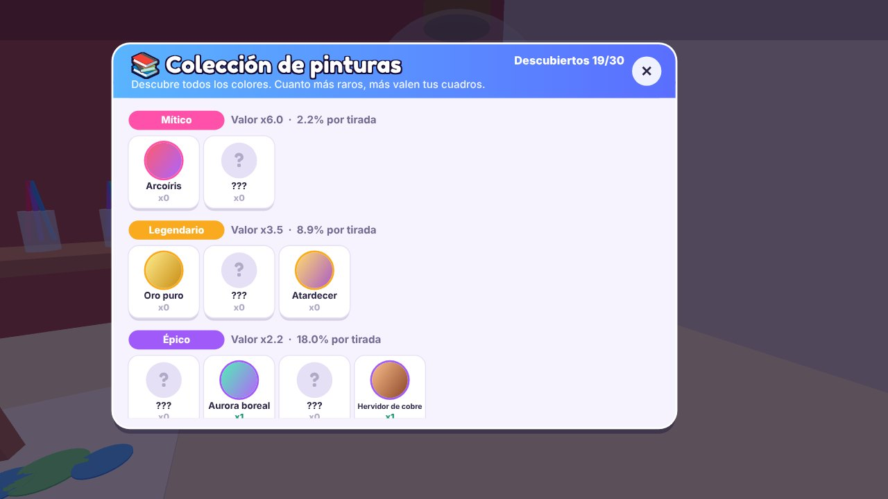

# 🎨 Galería Pincelada (juego de Roblox)

Cada jugador aparece en **su propio terreno privado**: una galería de arte con
un **taller** al lado, jardín, fuente, estanque y una calle por donde llegan
los visitantes. En el taller sacas pinturas de una máquina de colores (con
rarezas), eliges un diseño, decides qué color va en cada parte y lo pintas a
mano. Después lo cuelgas en tu galería y llegan visitantes (avatares reales de
Roblox, por ejemplo tus amigos) a comprarlo.


| Tu galería | Dentro del taller |
| --- | --- |
|  |  |

## Cómo se juega

Al entrar, un **tutorial de 5 pasos** te guía con flechas y resaltados:
tirar la máquina, empezar un cuadro, pintarlo, exponerlo y venderlo.



1. **Máquina de colores**: pulsa **🎲 TIRAR** (o acércate a la máquina) para
   conseguir pinturas. Al principio se tira **a mano**; el **Auto-Rolling** es
   una mejora que se compra en la tienda. Cada color tiene una rareza que
   **multiplica** el valor del cuadro:

   | Rareza | Multiplicador |
   | --- | --- |
   | Básico (infinito) | x1.0 |
   | Común | x1.1 |
   | Poco común | x1.3 |
   | Raro | x1.6 |
   | Épico (degradado) | x2.2 |
   | Legendario (degradado) | x3.5 |
   | Mítico (arcoíris, galaxia) | x6.0 |

2. **Elige un diseño**: hay **20 diseños en 5 niveles** (globo, gatito, koi,
   castillo, ballena, faro…). Los niveles altos se venden más caros. Para abrir
   un nivel tienes que pintar todos los diseños del anterior y luego
   desbloquear cada uno con dinero.
3. **Elige tus colores**: cada área del dibujo (cielo, globo, nubes…) toma el
   color que elijas, con el **valor del cuadro en vivo**. El botón
   ✨ *Mejores colores* elige automáticamente los que más rinden.
4. **Pinta**: el dibujo aparece en líneas y cada figura se rellena mientras
   pasas el pincel, con el % de cada área. Hay un **cronómetro con estrellas**:
   cuanto más rápido terminas, más vale el cuadro (⭐⭐ +10%, ⭐⭐⭐ +25%).
5. **Vende**:
   - 🖼️ **Expón** el cuadro en tu galería: un visitante entra caminando, lo
     mira y lo compra por un **25% más**. A veces llega un **coleccionista VIP
     👑** que paga **el doble**.
   - 💰 **Véndelo ya** si tienes prisa o la galería está llena.

| Elige un diseño | Elige tus colores |
| --- | --- |
|  |  |
| **Pintando contra el reloj** | **¡Terminado!** |
|  |  |

### Lo que te engancha

- **Misiones diarias 📜**: 3 misiones nuevas cada día (pintar, vender, tirar,
  conseguir colores raros, cuadros de 3 estrellas, ganar monedas). Si
  completas las 3 te llevas un **color Épico o mejor**.
- **Regalo diario 🎁** con **racha de 7 días**: cada día más monedas y un color
  raro; el día 7, un color Épico.
- **Colección de colores**: 30 pinturas para descubrir, con su probabilidad
  por tirada. Las que no tienes salen como «???».
- **Maestría** por diseño: 🥉 Bronce (3 cuadros, +5%), 🥈 Plata (8, +10%) y
  🥇 Oro (20, +20%).
- **9 mejoras**:
  - Máquina: suerte, velocidad y **Auto-Rolling** (tira sola mientras pintas).
  - Pintura: pincel grande y cubeta mágica (rellena una figura de un toque).
  - Galería: precios, fama (más visitantes y más VIP), más paredes (hasta 7
    cuadros en venta) y decoración (plantas, alfombra roja, estatua,
    guirnalda de luces, candelabro y arco de globos).
- **Visitantes con avatares reales**: tus amigos de Roblox (o avatares
  conocidos) entran caminando con animaciones, admiran el cuadro, celebran y
  te lo compran.
- El progreso se guarda automáticamente.

| Misiones | Regalo diario |
| --- | --- |
|  |  |
| **Mejoras** | **Colección** |
|  |  |


## Cómo abrirlo en Roblox Studio

### Opción fácil

1. Descarga **`GaleriaPincelada.rbxlx`**.
2. Ábrelo con **Roblox Studio** y pulsa **Play** ▶️. Todo (terreno, edificios,
   visitantes, interfaz) se crea por código y hay una pantalla de carga
   mientras se construye tu galería.

Para **publicarlo** y que se guarde el progreso:

1. *Archivo → Publicar en Roblox*.
2. *Configuración del juego → Seguridad*: activa **«Permitir que Studio acceda
   a los servicios de API»**.
3. *Configuración del juego → Lugares*: pon el **máximo de jugadores en 12**
   (cada servidor tiene 12 terrenos; si se llenara, el siguiente jugador
   recibe el primer terreno que quede libre).

### Opción para recibir cambios sin descargar nada (Rojo)

1. Clona el repositorio (por ejemplo con GitHub Desktop).
2. Instala [Rojo](https://rojo.space) y su plugin de Studio.
3. Ejecuta `rojo serve` en la carpeta del repositorio y pulsa
   *Rojo → Connect* en Studio.
4. Para cada actualización solo tienes que hacer *Pull* en GitHub Desktop y
   Studio se actualiza solo.

## Personalizar

- **Diseños nuevos**: `src/shared/Designs.lua`. Cada diseño se arma con
  figuras: `R` (rectángulo), `C` (círculo), `P` (píldora), `Heart`,
  `Sparkle` y `Ring`, sobre un lienzo de 0 a 1. Cada figura pertenece a un área.
- **Colores y rarezas**: `src/shared/Colors.lua`.
- **Economía, mejoras, estrellas, misiones y tutorial**: `src/shared/Config.lua`.
- **Terreno y edificios** (galería, taller, jardín, calle):
  `src/server/Services/WorldBuilder.lua`.

## Estructura

```
src/
  first/       Pantalla de carga
  shared/      Colores, diseños, configuración (servidor y cliente)
  server/      Terrenos, visitantes, guardado, máquina, ventas, misiones
  client/      Interfaz: HUD, máquina, diseños, colores, pintura, tienda...
tests/sim/     Simulador que ejecuta el juego completo fuera de Roblox
```

El servidor valida todo: pinturas suficientes, diseño desbloqueado, tiempo
mínimo de pintura, estrellas según el tiempo real y precios. Así los jugadores
no pueden hacer trampas.
